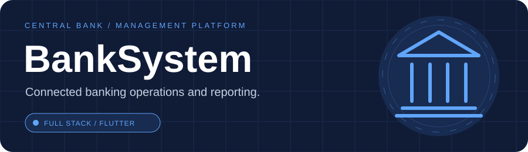
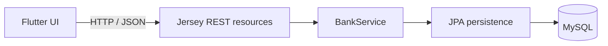

<div align="center">


# BankSystem — Central Bank Management

**A full-stack academic project for managing banks, customers, accounts and cards.**


</div>

## Overview

BankSystem connects a Flutter management interface with a Java REST backend and relational persistence. The project models central banking operations and provides tools for managing banking entities and retrieving operational reports.

## Core features

| Module | Functionality |
| --- | --- |
| Banks | List, create, update and delete bank records |
| Customers | Create, edit, delete and list customers, including bank-specific filtering |
| Accounts | Create accounts and retrieve customer accounts |
| Cards | Add cards and expose a card-validation endpoint |
| Reporting | Total balances, VIP customers, recent cards, bank rankings and customer risk reports |
| Mobile interface | Dashboard and management screens for banking entities |

## Architecture



## Tech stack

| Layer | Technologies |
| --- | --- |
| Frontend | Flutter, Dart, Material 3, HTTP |
| Backend | Java 17, JAX-RS, Jersey, Grizzly |
| Persistence | JPA, Hibernate, MySQL |
| Build | Maven |

## Selected API endpoints

Base path: `/api`

| Method | Endpoint | Purpose |
| --- | --- | --- |
| GET | /banks | List banks |
| POST | /add | Add a bank |
| GET | /customers | List customers by bank |
| POST | /customer | Create a customer |
| PUT / DELETE | /customers/{id} | Update or delete a customer |
| POST | /account | Create an account |
| POST | /card | Add a card |
| POST | /validate | Validate a card |
| GET | /reports/total-balance | Total balance per bank |
| GET | /reports/high-risk | High-risk customers |

## Repository structure

```text
BankSystem/
├── bank_app/
│   ├── lib/
│   │   ├── bank_dashboard.dart
│   │   ├── banks.dart
│   │   ├── customer.dart
│   │   └── ...
│   └── pubspec.yaml
├── bank_api/
│   ├── src/main/java/
│   └── pom.xml
└── docs/
```

## Getting started

```bash
git clone https://github.com/RodainaMohamed9/BankSystem.git
cd BankSystem
```

Backend (Java 17, Maven and MySQL):

```bash
cd bank_api
mvn compile exec:java
```

Configure the database connection before starting the backend. The server is configured to listen on port 8080 under `/api/`.

Mobile (Flutter with Dart 3.11 or compatible newer 3.x SDK):

```bash
cd bank_app
flutter pub get
flutter run
```

Run the mobile commands from the repository root and configure the API address in the Flutter app for your emulator or device.

## My contribution

**Rodaina Mohamed — Flutter mobile development.** My focus in this collaborative university project was building mobile interfaces and navigation for the banking application.

## Project status

Academic banking simulation. This documentation describes the source code, not a certified or production-ready banking service. Runtime setup and security properties have not been independently tested.

---

<div align="center">

**Connecting banking operations through software.**

[Developer profile](https://github.com/RodainaMohamed9)

</div>
